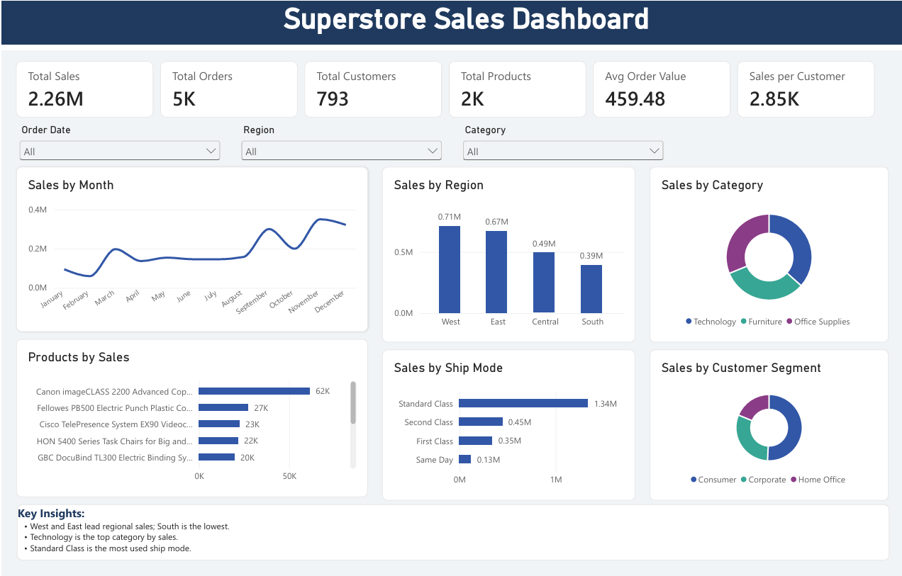

# Superstore Sales Dashboard (Power BI)

An interactive Power BI dashboard that analyzes Superstore sales data by month, region, category, customer segment and ship mode, with 6 KPIs and DAX measures.

## Objective
Help business users see what drives sales and where to focus.

## Tools Used
- Power BI Desktop
- DAX
- Superstore sales dataset

## Key Metrics (KPIs)
- Total Sales: 2.26M
- Total Orders: 5K
- Total Customers: 793
- Total Products: 2K
- Average Order Value: 459.48
- Sales per Customer: 2.85K

## Visuals
- Sales by Month (trend)
- Sales by Region
- Sales by Category and Customer Segment
- Top Products by Sales
- Sales by Ship Mode
- Slicers: Order Date, Region, Category

## DAX Measures
- Avg Order Value = DIVIDE([Total Sales], [Total Orders])
- Sales per Customer = DIVIDE([Total Sales], [Total Customers])

## Key Insights
- West and East lead regional sales; South is the lowest.
- Technology is the top category by sales.
- Standard Class is the most used ship mode.

## How to Use
Download the .pbix file and open it in Power BI Desktop.
